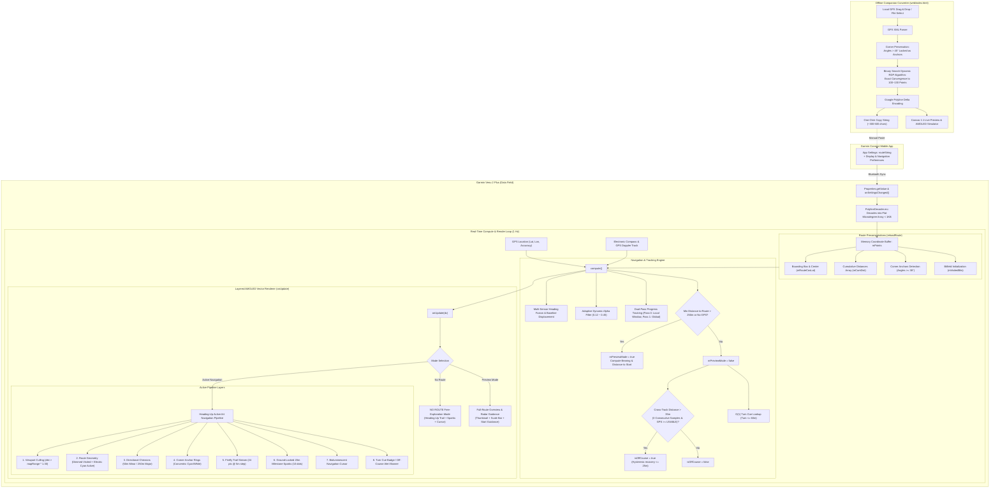

# Garmin Venu 2 Plus Breadcrumb Trail GPS Art Data Field Architecture & Specification

This document details the system architecture, mathematical algorithms, memory constraints, and implementation specifications for **He-Kim-Koo (Firefly)** GPS Breadcrumb Art Navigation.

> [!NOTE]
> **Phase 1 Implementation Complete**: All watch-side core navigation engines, zero-GC decoders, dynamic heading fusion, AMOLED vector rendering pipelines, full-route preview modes, and unit test suites are fully implemented and verified on the Garmin Connect IQ platform (API 3.2.0+, Venu 2 Plus 416x416 AMOLED).

---

## 1. System Architecture Overview



---

## 2. Implemented Watch Architecture & Subsystems

### 2.1 Ultra-Low Memory Profile (Zero-GC Flat Array & Bitfield)

Garmin Data Fields operate under an extremely stringent memory quota (32 KB to 64 KB total heap budget shared between the runtime environment, graphics context, and application logic). Standard object models (`Array<Location>` or nested arrays) trigger continuous heap allocation and garbage collection spikes, leading to immediate Out Of Memory (OOM) crashes.

#### Implemented Solutions:
1. **Flat Microdegree Coordinate Storage (`mPoints`)**:
   - Coordinates are stored as raw 32-bit integers in a single flat array: `[lat0, lon0, lat1, lon1, ...]`.
   - Stored in microdegrees ($10^{-5}$ degrees, where $25.03300^\circ \to 2503300$).
   - A typical 120-point route consumes only 240 integer elements ($< 1\text{KB}$ heap space).
2. **Zero-GC UTF-8 Polyline Decoder (`PolylineDecoder.mc`)**:
   - Converts the Google Encoded Polyline directly via `str.toUtf8Array()` (1 byte/character) instead of boxed `Array<Char>`.
   - Pre-allocates a fixed array buffer capped at `MAX_POINTS = 150` (300 coordinates) to prevent dynamic array reallocation.
3. **Packed 32-bit Bitfield for Visited Segments (`mVisitedBits`)**:
   - Rather than storing per-segment visited booleans in an array of objects, the watch uses an array of five 32-bit integers (`Array<Number>` of size 5 = 160 bits).
   - Bit operations (`idx >> 5` and `1 << (idx & 31)`) achieve $O(1)$ read/write in $< 20\text{ bytes}$ of heap memory.
4. **Pre-Allocated Geometry Buffers**:
   - All polygon scratchpads (runner navigation dart `mNavDart` and target arrow `mPolygonBuf`) are allocated once in `initialize()` and mutated in place, completely eliminating garbage collection overhead during `onUpdate()`.

---

### 2.2 Multi-Sensor Heading Fusion & Adaptive Dynamic Alpha Filter

To deliver a stable, jitter-free **Heading-Up (Course-Up)** display without arm-swing oscillation or turn lag:

```
                  +------------------------------------------------------+
                  | Current Running Speed (Activity.Info.currentSpeed)   |
                  +--------------------------+---------------------------+
                                             |
                  +--------------------------+--------------------------+
                  |                                                     |
         Speed < 0.6 m/s                                       Speed > 1.4 m/s
    (Stationary / Walking Pause)                              (Steady Running Pace)
                  |                                                     |
                  v                                                     v
          [ Deadband Lock ]                                  [ GPS Doppler Track ]
     Locks current rendered heading                        info.track direction of travel
                  |                                                     |
                  +--------------------------+--------------------------+
                                             |
                                  0.6 <= Speed <= 1.4 m/s
                                  (Jogging / Slow Motion)
                                             |
                                             v
                         [ Accumulated Baseline Ring Buffer ]
                         - 4-sample sliding window (3~4 seconds)
                         - Validated when displacement >= 3.0 meters
                         - Eliminates 1Hz differential noise
                                             |
                                             v
                           [ Electronic Compass Sanity Check ]
                         - Compares compass vs ground displacement
                         - Suppresses compass if divergence > 51°
```

1. **Multi-Stage Sensor Selection**:
   - **Stationary Deadband (`speed < 0.6 m/s`)**: Preserves the existing rendered heading to prevent wild rotations caused by GPS noise while standing still.
   - **Steady Running (`speed > 1.4 m/s`)**: Prioritizes `Activity.Info.track` (GPS Doppler course over ground), aligning the view strictly with human forward locomotion regardless of wrist orientation.
   - **Jogging / Transition (`0.6 ~ 1.4 m/s`)**: Uses a **4-sample accumulated baseline ring buffer** (`mHeadingHistLat`, `mHeadingHistLon`). It measures net displacement between the current position and the position from 3–4 seconds prior; only when net displacement $\ge 3.0\text{ meters}$ is a new bearing derived via `Math.atan2(dLon, dLat)`.
2. **Electronic Compass Sanity Watchdog (`checkCompassSanity`)**:
   - Continuously computes angular error between hardware magnetic heading (`currentHeading`) and ground motion vector.
   - If error exceeds $51^\circ$ for 3 or more consecutive samples, `mCompassReliable` drops to `false`, isolating the system from magnetic distortion and wrist tilt.
3. **Adaptive Dynamic Alpha Smoothing Filter**:
   - Smoothing utilizes circular wrapping $[-\pi, +\pi]$ via `wrapAngleRad()`:
   $$\Delta\theta = \text{wrapAngleRad}(\theta_{\text{target}} - \theta_{\text{render}})$$
   - **Straight running** ($|\Delta\theta| < 15^\circ$): $\alpha = 0.12$. Strong arm-swing noise suppression.
   - **Corner turning** ($|\Delta\theta| > 30^\circ$): $\alpha$ ramps smoothly up to $0.45$. Eliminates visual latency and tracks sharp $90^\circ$ turns instantly without overshoot.

---

### 2.3 Dual-Pass Progress Tracking & Snap Locking

GPS breadcrumb navigation must reliably track route progress even when paths loop back, intersect, or run along parallel streets.

1. **Two-Pass Nearest Segment Search (`updateRouteProgressAndCrossTrack`)**:
   - **Pass 0 (Local Forward Window)**: Searches segments in the window `[mCurrentSegmentIndex - 2 .. mCurrentSegmentIndex + 4]`.
   - **Pass 1 (Global Fallback)**: Searches all segments `[0 .. mPointCount - 2]`, but is **only executed if Pass 0 minimum distance exceeds the Snap Lock threshold ($45.0\text{m}$, `SNAP_LOCK_DIST_SQ = 2025.0f`)**.
   - This prevents false jumps onto crossing or return paths while maintaining automatic recovery if the runner joins mid-route.
2. **High-Performance Distance Metrics**:
   - All comparisons use squared Euclidean distances in metric space (`ax * ax + ay * ay`), postponing expensive square roots to a single `Math.sqrt()` call at the end of the search.
   - Local projection parameter $t \in [0.0, 1.0]$ tracks sub-segment progress along the line.
3. **Loop Route Wrap-Around**:
   - When reaching the final segment ($t > 0.85$), if unvisited segments remain or when within $50\text{m}$ of the start point, the tracker seamlessly cycles back to segment `0`.

---

### 2.4 Off-Course Detection with Debounce, Hysteresis & GPS Filtering

To avoid false alarms triggered by tall buildings or momentary multipath reflection:

| Parameter | Threshold | Purpose |
|---|---|---|
| **Trigger Distance** | $> 35.0\text{ m}$ | Cross-track deviation required to initiate off-course evaluation |
| **Debounce Count** | $3\text{ consecutive samples}$ | Must stay $>35\text{m}$ for 3 seconds continuously at 1 Hz |
| **Clear Distance (Hysteresis)** | $\le 25.0\text{ m}$ | Must recover within 25m to cancel alert (prevents edge oscillation) |
| **GPS Quality Filter** | $\ge \text{QUALITY\_USABLE}\ (3)$ | Alerts suppressed completely when GPS accuracy is poor |

When triggered, an alert banner is displayed at the top of the screen:
`OFF COURSE (+<distance>m)` in high-contrast alert red (`0xDC2626`).

---

### 2.5 Real-Time Turn Cue System (Turn-by-Turn Guidance)

1. **Precomputed Corner Anchors (`computeCornerAnchors`)**:
   - During route loading, the vector angle between consecutive segments is evaluated.
   - Any vertex with a turning angle $|\Delta\text{heading}| \ge 38^\circ$ (`CORNER_MIN_ANGLE_DEG`) is precomputed into `mCornerIndices` and `mCornerAngles`.
2. **$O(1)$ Upcoming Turn Detection (`updateTurnCue`)**:
   - Utilizing the precomputed cumulative distance lookup `mCumDist`, the system calculates runner distance along the track:
     $$d_{\text{runner}} = d_{\text{seg\_start}} + (d_{\text{seg\_end}} - d_{\text{seg\_start}}) \times t$$
   - Finds the immediate next corner index ahead; if remaining distance $\le 60.0\text{m}$, turn guidance activates.
3. **Dual-Stage Turn Cue Visual Styling**:
   - **Approaching ($21\text{m} \sim 60\text{m}$)**: Slate-900 background (`0x0F172A`) with sky blue border (`0x38BDF8`), showing a crisp vector turn arrow (left or right) and remaining distance.
   - **Imminent ($\le 20\text{m}$)**: High-attention Amber-600 background (`0xD97706`) with Amber-400 border (`0xFBBF24`), prompting the runner to turn immediately.

---

### 2.6 Bioluminescent Night Aesthetics & AMOLED Vector Pipeline

Designed specifically for AMOLED displays to achieve maximum legibility, zero backlight bleed, and optimized power consumption.

```
+-----------------------------------------------------------------------------------+
| Color Layer Hierarchy                                                             |
+-----------------------------------------------------------------------------------+
| Background         AMOLED Pure Black (0x000000)                                   |
| Completed Path     Dimmed Slate-Cyan (0x004047, 28% luminance, 3px pen)           |
| Active Blueprint   Electric Cyan (0x00E5FF, 4px pen)                              |
| Corner Anchors     Concentric circles (6px outer dimmed, 3px cyan, 1px white core)|
| Direction Chevrons Minor 50m (width 10px, 2px pen) / Major 250m (width 20px, 4px)|
| Firefly Trail      Bioluminescent Lime Green (0xA3E635, 3px pen, 24 pts @ 5m step)|
| Milestone Sparks   10 ground-locked dots @ 20m interval with 3-tier fading radius |
| Runner Cursor      Lime navigation chevron + 2px white border + white guidance dot|
| Status Badges      Off-Course (Red) / Turn Cue (Slate/Amber) / No Route (Capsule) |
+-----------------------------------------------------------------------------------+
```

#### Implemented Visual Details:
1. **Dynamic Segment Split Rendering**:
   - Visited segments render in dimmed slate-cyan (`0x004047`).
   - The active segment splits at progress $t$: the completed portion $[0, t]$ is dimmed, while the remaining portion $[t, 1]$ glows in vibrant Electric Cyan (`0x00E5FF`).
2. **On-the-Fly Hierarchical Direction Chevrons**:
   - Calculated dynamically from `mCumDist` without allocating static chevron point arrays (saving ~7 KB memory).
   - Minor chevrons appear every $50\text{m}$ ($2\text{px}$ pen); Major landmark chevrons appear every $250\text{m}$ ($4\text{px}$ bold).
   - Chevrons passed by the runner dim automatically.
3. **Firefly Trailing Wake & 20m Milestone Sparks**:
   - **Comet Trail**: 24-point circular ring buffer with $5.0\text{m}$ step threshold (~$120\text{m}$ wake). Connects seamlessly to the runner chevron's tail.
   - **20m Milestone Sparks**: 10 ground-locked coordinates planted every $20.0\text{m}$ ($200\text{m}$ visual gauge). Sparks stay stationary on the ground and feature a 3-tier brightness/size gradient based on age.
4. **Viewport Culling**:
   - Any segment or spark located farther than `mapRange * 1.30` from the runner is culled before coordinate transformation, maintaining high 1 Hz frame rates and battery efficiency.

---

### 2.7 Full-Route Overview & Far-Away Preview Mode

When the runner has not yet started or has temporarily stepped away from the route, the Data Field transitions into **Preview Mode**:

```
                       [ Full-Route Preview Mode ]
              (Triggered when: !mHasGps OR minDist > 250m)

                       +-----------------------+
                       |   12 o'clock Tick     |
                       |       [ | ]           |
                   . - '           ' - .       | Outer Compass Ring
               . '                       ' .   |
             /        +---------------+      \ |
            |         | Route Artwork |       || Dynamic scale decimation
            |         |   Thumbnail   |       || (Δ² < 9 px collapsed)
            |         +---------------+       ||
            |                                 || Start Landmark (Lime halo)
            |            |--- 500m ---|       || Adaptive scale bar
             \                               / |
               . '     ( 12.4 km )       ' .   | Distance capsule pill
                   . - . _       _ . - .       |
                          \     /              | Target Arrow with START
                           \ v /               | & distance label
```

1. **Trigger Conditions**:
   - GPS satellite lock not yet established (`!mHasGps`), OR
   - Nearest distance to route exceeds $250\text{m}$ (`minDist > PREVIEW_DIST_M`).
2. **Visual Components**:
   - **Outer Compass Ring**: Circular boundary with a prominent 12 o'clock reference tick aligned to watch heading.
   - **Auto-Centered Route Thumbnail**:
     - Bounds calculated dynamically; scaled to fit $56\% \times 36\%$ screen area.
     - **Scale-based decimation**: Vertices closer than 3 screen pixels ($\Delta^2 < 9$) are collapsed dynamically, preserving complex geometry with zero extra memory.
     - **Start & End Landmarks**: Start point highlighted with an 8px lime halo; end point rendered in cyan (auto-hidden if loop route detected).
   - **Adaptive Visual Scale Bar**: Iterates standard metric intervals ($50\text{m}, 100\text{m}, 200\text{m}, 500\text{m}, 1\text{km}, \dots$) to select the optimal scale representation ($|\text{── } 500\text{ m ──}|$).
   - **Total Distance Capsule**: Displays route distance formatted in kilometers or meters inside a dark midnight slate pill.
   - **Start Guidance & Radial Anti-Collision Label**:
     - If runner position is within the dial area, renders the runner chevron and a lime dotted guidance line to the starting vertex.
     - If outside, renders a **Target Arrow** along the outer ring pointing toward the start.
     - **Radial text placement algorithm**: Automatically calculates text boundary projections along the target angle vector, guaranteeing no visual overlap between the "START + distance" label and the arrow at any orientation ($0^\circ \sim 360^\circ$).

---

### 2.8 Free-Exploration ("NO ROUTE") Mode

When no route string is configured (`mPointCount < 2`):
- Operates in Heading-Up free navigation mode.
- Renders the runner cursor, live firefly wake, and 20m milestone sparks as the user runs freely.
- Features a stylized **"NO ROUTE"** pill capsule badge centered at the top display area.
- If GPS is not acquired, displays `"WAITING FOR GPS..."` or `"SEARCHING GPS..."`.

---

### 2.9 User Configuration Properties Schema

Configurable via Garmin Connect Mobile or Connect IQ Store App Settings:

| Property ID | Type | Default | Range / Values | Description |
|---|---|---|---|---|
| `routeString` | String | `""` | Max 2048 chars | Compressed Google Encoded Polyline |
| `mapRange` | Number | `175` | $50\sim 1000\text{ m}$ | Display radius mapped to watch screen edge |
| `routeDirection` | Number | `0` | `0`: Forward, `1`: Reverse | In-place coordinate array reversal |
| `showDirection` | Boolean | `true` | `true` / `false` | Directional chevrons toggle (50m/250m) |
| `dimCompletedPath`| Boolean | `true` | `true` / `false` | Dimming completed track to slate-cyan |
| `showTurnCue` | Boolean | `true` | `true` / `false` | Upcoming turn banner toggle (60m window) |
| `showCornerAnchors`| Boolean | `true` | `true` / `false` | Visual anchor rings at sharp turns ($\ge 38^\circ$)|

---

## 3. Test Verification Suite (`RouteApp.mc`)

The watch implementation includes a built-in automated test suite (`(:test) testLoadRoute`), executable in the Connect IQ Simulator:

1. **Polyline Decoding Accuracy**: Verifies delta decoding into microdegree arrays and point count integrity.
2. **Preview Mode without GPS**: Verifies thumbnail centering, scale bar formatting, and waiting banner.
3. **Preview Mode Far Away**: Verifies target direction arrow and distance-to-start calculation.
4. **Preview Mode Near Start**: Verifies user orientation dart and dotted guidance line rendering.
5. **Active Navigation Mode**: Validates heading-up projection, segment culling, and vector layer drawing.
6. **No-Route Free Exploration Mode**: Validates trail and spark rendering in blank state.
7. **Off-Course Debounce & Hysteresis**:
   - Asserts single/double deviations $>35\text{m}$ do not trigger alerts.
   - Asserts 3 consecutive samples $>35\text{m}$ trigger off-course state.
   - Asserts hysteresis deadband ($26\sim 35\text{m}$) retains alert.
   - Asserts recovery $\le 25\text{m}$ clears off-course alert.
   - Asserts low GPS quality (`< QUALITY_USABLE`) rejects ghost alerts.

---

## 4. Phase 1 Completion Summary & Phase 2 Roadmap

### Phase 1 Achievements (Completed)
- [x] Zero-GC Google Polyline decoder for microdegree flat arrays.
- [x] Multi-sensor heading fusion (GPS Doppler + accumulated baseline + electronic compass sanity watchdog).
- [x] Adaptive Dynamic Alpha Filter ($\alpha = 0.12 \sim 0.45$) for jitter-free straight lines and responsive cornering.
- [x] Dual-pass route progress tracking with 45m snap locking and closed-loop wrap-around.
- [x] Packed 32-bit bitfield visited path dimming with active-segment sub-progress split.
- [x] On-the-fly 50m minor and 250m major milestone directional chevrons.
- [x] Bioluminescent firefly trail (24 pts @ 5m) and ground-locked 20m milestone sparks (10 dots @ 20m).
- [x] Real-time Turn Cue (TBT) system with 2-stage visual warnings (approaching slate-blue vs imminent amber).
- [x] Robust off-course detection with 3-second debounce, 25m hysteresis deadband, and GPS quality gating.
- [x] Full-Route Preview Mode with auto-scaled thumbnail, adaptive scale bar, distance pill, and radial collision-free guidance arrow.
- [x] Blank "NO ROUTE" free-exploration mode.
- [x] Comprehensive 6-domain unit test suite.

### Phase 2 Potential Enhancements (Planned)
- [ ] **Haptic Alerts**: Add gentle vibration patterns for imminent turns ($\le 20\text{m}$) and off-course warnings on supported devices.
- [ ] **Expanded Device Profiles**: Add support for Forerunner 265/965, Fenix 7/8, and Epix AMOLED displays.
- [ ] **Elevation Profile Overlay**: Compact elevation sparkline at the bottom edge for trail GPS art courses.
