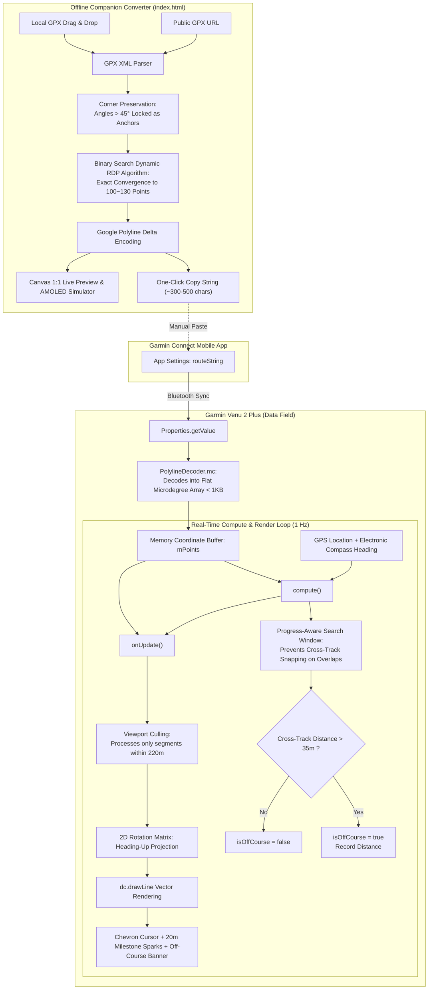

# Garmin Venu 2 Plus Breadcrumb Trail GPS Art Data Field Architecture & Specification

This document details the system architecture, mathematical algorithms, memory constraints, and module specifications for **He-Kim-Koo (Firefly)** GPS Breadcrumb Art Navigation.

---

## 1. System Architecture Overview

---

## 2. Key Architecture Decisions & Constraints

### 2.1 Ultra-Low Memory Profile (Flat Array)

- **Garmin Data Field Memory Budget**: Limited to 32KB ~ 64KB across the background service and UI pool.
- **Object Overhead**: Using standard `Array<Array<Double>>` or `Array<Location>` incurs tens of kilobytes in object pointer overhead and triggers frequent garbage collection (GC), causing Out Of Memory (OOM) crashes.
- **Flat Microdegree Solution**: Coordinates are stored in a single flat `Array<Number>`, where even indices store latitude and odd indices store longitude in microdegrees ($10^{-5}$ degrees, e.g., $25.03300^\circ \to 2503300$). A 120-point route requires only 240 32-bit integers, consuming $< 1\text{KB}$ heap space.

### 2.2 Speed-Aware Dynamic Heading, Heading-Up Projection & Angular Exponential Smoothing

- **Speed-Aware Dynamic Heading**:
  - In motion (`currentSpeed > 0.8 m/s`), prioritizes `Activity.Info.track` (GPS Ground Course / Direction of Travel) over the electronic compass. This ensures the Heading-Up perspective strictly aligns with human forward running movement, eliminating wrist-tilt bias from wearing the watch on the left or right wrist.
  - When stationary (`currentSpeed <= 0.8 m/s`), falls back to `Activity.Info.currentHeading` (hardware 3-axis electronic compass) so runners can orient themselves while standing still.
- **Angular Exponential Smoothing**:
  To prevent jarring perspective snaps when making sharp $90^\circ$ turns or experiencing transient GPS heading jitter, an angular smoothing filter with $[-\pi, +\pi]$ circular difference wrapping is implemented. It smooths rotation toward the target heading by ~40% per second.

### 2.3 Bioluminescent Night Aesthetics & Trailing Wake System (Plan A)

1. **Color Hierarchy**:
   - Background: AMOLED Deep Night Black (`COLOR_BLACK`).
   - **Firefly Cursor (Runner)**: Sleek modern GPS Navigation Chevron with bioluminescent cold lime-green body (`#a3e635` / `COLOR_GREEN`), 2px crisp white outline, and a bright white guidance core dot.
   - **Trailing Wake (80-point stream + 20m ground-locked sparks)**:
     - **Comet Stream Line**: 80-point circular ring buffer covering ~200 meters. Tapers smoothly from 5.0px near the runner down to 1.8px at the tail end, providing silky cornering visualization.
     - **20m Milestone Sparks (10 dots covering 200m)**: Points are locked to absolute geographic coordinates (Ground-Locked Coordinates). When the runner advances every 20.0 meters, a spark is planted on the ground and **remains stationary in place**, fading out gracefully over distance/time. Runners can instantly gauge running distance ($10 \times 20\text{m} = 200\text{m}$).
   - **Route Blueprint (Unified Full Course)**: Electric Cyan (`COLOR_BLUE` / `#00e5ff`, 4px width), high-contrast blueprint guiding the runner forward. Completed segments retain the same cyan color to eliminate state tracking and redundant data processing.
   - **Hierarchical Directional Chevrons (50m & 250m Gauge)**: Chevrons rendered along the cumulative route in matching Electric Cyan (`#00e5ff`). Minor chevrons (`>`, width 10px, 2px pen) appear every 50m, while major landmark chevrons (`>`, bold single chevron, width 20px, 4px pen) appear every 250m ($50\text{m} \times 5$). Runners can instantly gauge distances by counting the prominent 250m markers. Toggleable via `showDirection` in App Settings.
   - **Forward / Reverse Direction Inversion**: Configurable in App Settings (`routeDirection`: 0 = Forward, 1 = Reverse). Reverses the coordinate array in-place during `reloadRoute()` with zero runtime overhead.

### 2.4 High-Efficiency Route Distance Calculation

1. **Single-Pass Nearest Segment Search**:
   - Computes minimum Euclidean distance to all route segments in a single pass without maintaining segmented progress indexes.
   - Eliminates out-of-order segment jumps and simplifies GPS data handling.
2. **Corner Preservation**:
   - The web converter calculates turning angles prior to simplification: any vertex with an angle $> 45^\circ$ is permanently locked as an anchor point.

### 2.5 Configurable Map View Range & Viewport Culling

- **User-Configurable Map Range (`mapRange`)**: Configurable in Garmin Connect App Settings (50m to 1000m, default 175m). Dynamic zoom scale `zoomScale = (width / 2) / mapRange` ensures any Garmin screen radius maps precisely to the runner's preferred distance in meters.
- **Rendering Optimization (Viewport Culling)**: Line segments and sparks exceeding `mapRange * 1.30` from the runner are culled before matrix multiplication, drastically reducing CPU load and AMOLED power consumption.

### 2.6 Initial Waiting State Full-Route Thumbnail

- In the initial state prior to acquiring a GPS lock (`!mHasEverHadGps`), the Data Field renders a full overview thumbnail of the GPS art centered underneath the "WAITING FOR GPS" header.
- **Dynamic Scale-Based Point Decimation**: Coordinates are mapped to screen pixels based on the route bounding box. Successive vertices closer than 3 screen pixels ($\Delta^2 < 9$) are collapsed, dynamically simplifying dense point clusters while retaining geometric corners and endpoints with $O(1)$ memory.
- **Start/End Anchors**: Highlights the route start point (bright green) and destination (crisp white) to give runners spatial awareness while waiting for satellite fix.

---

## 3. Project File Structure

- `manifest.xml`: Connect IQ application declaration (declares `<iq:uses-permission id="Positioning"/>` for `Activity.Info.currentLocation`)
- `monkey.jungle`: Monkey C build jungle configuration
- `resources/settings/properties.xml`: Application properties definition
- `resources/settings/settings.xml`: User settings form schema
- `resources/strings/strings.xml`: Localized string resources
- `resources/drawables/drawables.xml`: Bitmap drawable resource declarations
- `resources/drawables/launcher_icon.png`: 70x70 native AMOLED launcher icon
- `source/PolylineDecoder.mc`: Zero-GC Google Polyline decoder
- `source/RouteApp.mc`: Application lifecycle and live settings listener
- `source/RouteDataField.mc`: Real-time navigation, vector rendering, and smoothing
- `index.html`: Offline GPX simplifier and 1:1 Venu 2 Plus AMOLED simulator
- `README.md`: Compilation, sideloading, and operational guide
