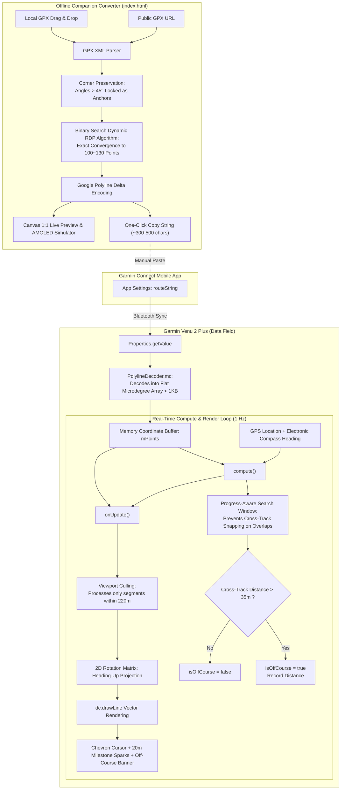

# Garmin Venu 2 Plus Breadcrumb Trail GPS Art Data Field Architecture & Specification

This document details the system architecture, mathematical algorithms, memory constraints, and module specifications for **He-Kim-Koo (Firefly)** GPS Breadcrumb Art Navigation.

---

## 1. System Architecture Overview

---

## 2. Key Architecture Decisions & Constraints

### 2.1 Ultra-Low Memory Profile (Flat Array)
- **Garmin Data Field Memory Budget**: Limited to 32KB ~ 64KB across the background service and UI pool.
- **Object Overhead**: Using standard `Array<Array<Double>>` or `Array<Location>` incurs tens of kilobytes in object pointer overhead and triggers frequent garbage collection (GC), causing Out Of Memory (OOM) crashes.
- **Flat Microdegree Solution**: Coordinates are stored in a single flat `Array<Number>`, where even indices store latitude and odd indices store longitude in microdegrees ($10^{-5}$ degrees, e.g., $25.03300^\circ \to 2503300$). A 120-point route requires only 240 32-bit integers, consuming $< 1\text{KB}$ heap space.

### 2.2 Electronic Compass, Heading-Up Projection & Angular Exponential Smoothing
- Garmin Venu 2 Plus features a hardware 3-axis electronic compass.
- `Activity.Info.currentHeading` provides GPS bearing when in motion and seamlessly switches to the hardware compass when stationary.
- **Angular Exponential Smoothing**:
  To prevent jarring perspective snaps when making sharp $90^\circ$ turns or experiencing transient GPS heading jitter, an angular smoothing filter with $[-\pi, +\pi]$ circular difference wrapping is implemented. It smooths rotation toward the target heading by ~40% per second.

### 2.3 Bioluminescent Night Aesthetics & Trailing Wake System (Plan A)
1. **Color Hierarchy**:
   - Background: AMOLED Deep Night Black (`COLOR_BLACK`).
   - **Firefly Cursor (Runner)**: Sleek modern GPS Navigation Chevron with bioluminescent cold lime-green body (`#a3e635` / `COLOR_GREEN`), 2px crisp white outline, and a bright white guidance core dot.
   - **Trailing Wake (80-point stream + 20m ground-locked sparks)**:
     - **Comet Stream Line**: 80-point circular ring buffer covering ~200 meters. Tapers smoothly from 5.0px near the runner down to 1.8px at the tail end, providing silky cornering visualization.
     - **20m Milestone Sparks (10 dots covering 200m)**: Points are locked to absolute geographic coordinates (Ground-Locked Coordinates). When the runner advances every 20.0 meters, a spark is planted on the ground and **remains stationary in place**, fading out gracefully over distance/time. Runners can instantly gauge running distance ($10 \times 20\text{m} = 200\text{m}$).
   - **Upcoming Route Blueprint**: Electric Cyan (`COLOR_BLUE` / `#00e5ff`, 4px width), high-contrast blueprint guiding the runner forward.
   - **Completed Route Artwork**: Warm Golden Amber (`COLOR_ORANGE` / `#f59e0b`, 4px width with milestone node dots), representing the finished geometric art illuminated by the firefly.

### 2.4 Complex GPS Art Handling
1. **Corner Preservation**:
   - Critical text strokes and cartoon facial features in GPS art can be flattened by traditional Ramer-Douglas-Peucker (RDP) decimation.
   - The web converter calculates turning angles prior to simplification: any vertex with an angle $> 45^\circ$ is permanently locked as an anchor point.
2. **Progress-Aware Search Window**:
   - GPS art frequently contains loops, self-intersections, and out-and-back segments on the same street.
   - `compute()` restricts local nearest-point search to `[mProgressIdx - 2, mProgressIdx + 5]`, preventing premature snapping to future laps. A global search is only invoked when the runner is genuinely off-track or taking a shortcut.

### 2.5 Viewport Culling
- Fixed scale: `ZOOM_SCALE = 1.2f` (1 meter = 1.2 pixels; 416x416 round screen covers a radius of ~173 meters).
- Rendering optimization: Line segments with both endpoints exceeding 220 meters from the runner are culled before matrix multiplication, drastically reducing CPU load and AMOLED power consumption.

---

## 3. Project File Structure

- `manifest.xml`: Connect IQ application declaration
- `monkey.jungle`: Monkey C build jungle configuration
- `resources/settings/properties.xml`: Application properties definition
- `resources/settings/settings.xml`: User settings form schema
- `resources/strings/strings.xml`: Localized string resources
- `resources/drawables/drawables.xml`: Bitmap drawable resource declarations
- `resources/drawables/launcher_icon.png`: 70x70 native AMOLED launcher icon
- `source/PolylineDecoder.mc`: Zero-GC Google Polyline decoder
- `source/RouteApp.mc`: Application lifecycle and live settings listener
- `source/RouteDataField.mc`: Real-time navigation, vector rendering, and smoothing
- `index.html`: Offline GPX simplifier and 1:1 Venu 2 Plus AMOLED simulator
- `README.md`: Compilation, sideloading, and operational guide
